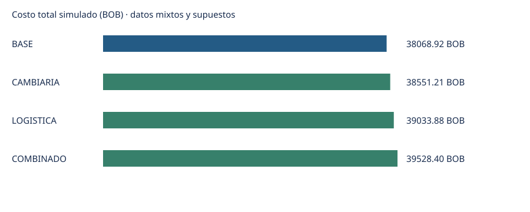

# HU-06: comparar escenarios cambiarios y logísticos

Fecha de análisis: 2026-10-23

**Resultado MIXTO_SIMULADO.** Los precios y cantidades son ficticios. Las referencias conservan la clasificación de HU-31/HU-32; los parámetros físicos y gastos complementarios son supuestos o datos sintéticos.

## Pedido analizado

Simulación de un pedido consolidado con cinco órdenes históricas de prueba de MULTIPARTES. Se mantienen sus productos, cantidades y precios originales.

Se conservan 5 líneas válidas, 5 productos distintos y 205 unidades; mercancía: 2740.85 USD.

| Orden | Movimiento | Repuesto | Cantidad | Precio USD | Mercancía USD |
|---|---|---|---:|---:|---:|
| OC-5003 | 1005 | REP-0002 | 40 | 10.28 | 411.20 |
| OC-5006 | 1011 | REP-0004 | 10 | 64.17 | 641.70 |
| OC-5008 | 1015 | REP-0006 | 100 | 4.91 | 491.00 |
| OC-5010 | 1020 | REP-0008 | 20 | 39.95 | 799.00 |
| OC-5011 | 1021 | REP-0009 | 35 | 11.37 | 397.95 |

Exclusiones por HU-17: 1006 (OC-5003, DUPLICADO); 1016 (OC-5008, DUPLICADO); 1022 (OC-5011, DUPLICADO).

## Comparación

| Escenario | TC BOB/USD | Mercancía USD | Logística USD | Logística BOB de origen | Total BOB | Diferencia BOB | Diferencia % |
|---|---:|---:|---:|---:|---:|---:|---:|
| BASE | 11.84 | 2740.85 | 474.43 | 0 | 38068.92 | 0.00 | 0.00 |
| CAMBIARIA | 11.99 | 2740.85 | 474.43 | 0 | 38551.21 | 482.29 | 1.27 |
| LOGISTICA | 11.84 | 2740.85 | 555.93 | 0 | 39033.88 | 964.96 | 2.53 |
| COMBINADO | 11.99 | 2740.85 | 555.93 | 0 | 39528.40 | 1459.48 | 3.83 |

- **BASE (BASE):** TCO BCB y flete/seguro implícito INE AEREA. Referencia TCO_BCB del 2026-10-23.
- **CAMBIARIA (CAMBIARIA):** Solo cambia el TCO por la referencia de venta P2P del mismo día. Referencia PARALELO_P2P_VENTA del 2026-10-23.
- **LOGISTICA (LOGISTICA):** Solo cambia la referencia internacional de AEREA a COURRIER; se recalculan los gastos sobre CIF. Referencia TCO_BCB del 2026-10-23.
- **COMBINADO (COMBINADO):** Referencia P2P y estimación internacional COURRIER, con la misma canasta. Referencia PARALELO_P2P_VENTA del 2026-10-23.

## Impacto cambiario

CAMBIARIA mantiene mercancía y parámetros logísticos del base. Cambiar de 11.84 a 11.99 BOB/USD produce una diferencia de 482.29 BOB (1.27%). Los gastos originalmente en BOB permanecen sin conversión.

## Impacto logístico

LOGISTICA mantiene productos, cantidades, precios y cambio del base. La logística en USD pasa de 474.43 a 555.93; el efecto total es 964.96 BOB (2.53%). Los porcentajes sobre CIF se recalculan cuando cambia su base.

## Desglose logístico y trazabilidad

| Escenario | Concepto | Tarifa | Unidad original | Base aplicada | Moneda | Importe | Naturaleza de referencia | Fecha del dato |
|---|---|---:|---|---:|---|---:|---|---|
| BASE | flete y seguro implícito (CIF-FOB), origen China, medio AEREA | 3.2056 | USD por kg (11.5% del FOB) | 100 | USD | 320.56 | ESTIMACION | 2025-09 a 2026-08 |
| BASE | nacionalizacion y agente aduanero | 3.476 | % del CIF | 3061.41 | USD | 106.41 | SINTETICO | 2026-09 |
| BASE | comision de gestion de importacion | 1.142 | % del CIF | 3061.41 | USD | 34.96 | SINTETICO | 2026-09 |
| BASE | flete terrestre Arica/Iquique -> Santa Cruz | 0.125 | USD por kg | 100 | USD | 12.50 | SINTETICO | 2026-09 |
| CAMBIARIA | flete y seguro implícito (CIF-FOB), origen China, medio AEREA | 3.2056 | USD por kg (11.5% del FOB) | 100 | USD | 320.56 | ESTIMACION | 2025-09 a 2026-08 |
| CAMBIARIA | nacionalizacion y agente aduanero | 3.476 | % del CIF | 3061.41 | USD | 106.41 | SINTETICO | 2026-09 |
| CAMBIARIA | comision de gestion de importacion | 1.142 | % del CIF | 3061.41 | USD | 34.96 | SINTETICO | 2026-09 |
| CAMBIARIA | flete terrestre Arica/Iquique -> Santa Cruz | 0.125 | USD por kg | 100 | USD | 12.50 | SINTETICO | 2026-09 |
| LOGISTICA | flete y seguro implícito (CIF-FOB), origen China, medio COURRIER | 3.9846 | USD por kg (17.6% del FOB) | 100 | USD | 398.46 | ESTIMACION | 2025-09 a 2026-08 |
| LOGISTICA | nacionalizacion y agente aduanero | 3.476 | % del CIF | 3139.31 | USD | 109.12 | SINTETICO | 2026-09 |
| LOGISTICA | comision de gestion de importacion | 1.142 | % del CIF | 3139.31 | USD | 35.85 | SINTETICO | 2026-09 |
| LOGISTICA | flete terrestre Arica/Iquique -> Santa Cruz | 0.125 | USD por kg | 100 | USD | 12.50 | SINTETICO | 2026-09 |
| COMBINADO | flete y seguro implícito (CIF-FOB), origen China, medio COURRIER | 3.9846 | USD por kg (17.6% del FOB) | 100 | USD | 398.46 | ESTIMACION | 2025-09 a 2026-08 |
| COMBINADO | nacionalizacion y agente aduanero | 3.476 | % del CIF | 3139.31 | USD | 109.12 | SINTETICO | 2026-09 |
| COMBINADO | comision de gestion de importacion | 1.142 | % del CIF | 3139.31 | USD | 35.85 | SINTETICO | 2026-09 |
| COMBINADO | flete terrestre Arica/Iquique -> Santa Cruz | 0.125 | USD por kg | 100 | USD | 12.50 | SINTETICO | 2026-09 |

La naturaleza corresponde a la referencia: un importe derivado de tarifa DOCUMENTADO/ESTIMACION y peso supuesto sigue siendo una simulación. El detalle CSV conserva fuente, respaldo, alcance, fecha, unidad y SHA-256 del archivo de entrada.

## Parámetros físicos y modificaciones expresas

- **BASE:** peso_kg=100 [SINTETICO, 2026-10-23]: Supuesto sintético de 100 kg brutos para el pedido consolidado; no existe pesaje por orden ni se deduce el peso de las cantidades. Se mantiene fijo en los cuatro escenarios.
- **CAMBIARIA:** peso_kg=100 [SINTETICO, 2026-10-23]: Supuesto sintético de 100 kg brutos para el pedido consolidado; no existe pesaje por orden ni se deduce el peso de las cantidades. Se mantiene fijo en los cuatro escenarios.
- **LOGISTICA:** peso_kg=100 [SINTETICO, 2026-10-23]: Supuesto sintético de 100 kg brutos para el pedido consolidado; no existe pesaje por orden ni se deduce el peso de las cantidades. Se mantiene fijo en los cuatro escenarios.
- **COMBINADO:** peso_kg=100 [SINTETICO, 2026-10-23]: Supuesto sintético de 100 kg brutos para el pedido consolidado; no existe pesaje por orden ni se deduce el peso de las cantidades. Se mantiene fijo en los cuatro escenarios.

Componentes declarados incluidos en el precio: ninguno.

## Fórmulas y redondeo

Mercancía USD = suma de cantidad × precio de cada línea. Cada línea y cada gasto se redondean a 0,01 en su moneda con Decimal y ROUND_HALF_UP. Cada importe USD se convierte y redondea individualmente a BOB; los importes BOB no se convierten. El total es la suma de esas líneas en BOB, por lo que coincide exactamente con el detalle y puede diferir en centavos de convertir el agregado USD una sola vez.

CIF simulado = mercancía + flete internacional + seguro. Si el seguro es s% del propio CIF: seguro = (mercancía + flete) × s / (100 − s), redondeado antes de calcular los demás porcentajes. El transporte local se agrega después del CIF. No se permite sumar otro seguro cuando el flete ya lo incluye.

Diferencia BOB = total del escenario − total base (positiva: mayor costo; negativa: ahorro). Diferencia % = diferencia / total base × 100, redondeada a dos decimales. El base tiene diferencia cero.

## Supuestos y limitaciones

- Los precios históricos se tratan como valor de mercancía sin los cinco gastos adicionales del modelo; no hay Incoterm documentado. No representan precios FOB comprobados.
- Las cinco órdenes de septiembre se consolidan de forma hipotética en un solo pedido valorado con referencias cambiarias del 23/10/2026. No se reconstruye el costo histórico de sus pagos.
- Los promedios del INE AEREA y COURRIER se usan como aproximaciones alternativas hasta frontera de Bolivia. No son cotizaciones de una ruta concreta ni permiten comparar tiempos de entrega.
- El tramo frontera de Bolivia a Santa Cruz se aproxima con la tarifa sintética Arica/Iquique -> Santa Cruz. Se supone separado del tramo internacional; la ruta real debe validarse antes de una decisión.
- Nacionalización/agente y comisión se aproximan con los porcentajes sintéticos de HU-31 sobre el CIF simulado. No se han determinado aranceles, IVA ni otros tributos reales; el total es del alcance simulado.
- Las fuentes se conservan como estaban en el repositorio; DOCUMENTADO identifica el respaldo registrado por HU-31/HU-32, no una verificación nueva de su vigencia.
- No se rellenan tipos de cambio faltantes ni se usan índices como importes. Un costo pendiente o un parámetro físico ausente impide generar resultados nuevos.
- Se cubren los cinco componentes del modelo (flete internacional, seguro, nacionalización/agente, comisión y flete local). Eso no certifica que estén cubiertos todos los gastos o tributos de una importación real.
- Los escenarios obligatorios conservan la canasta. Las modificaciones expresas se admiten en COMBINADO y quedan registradas; modificar cantidades exige redeclarar los parámetros físicos usados.

## Fuentes utilizadas

- `data/processed/hu-30-31/hu31_costos_importacion.csv`; dato: 2025-09 a 2026-08; INE importaciones, ine_repuestos_flete_implicito_mensual.csv
- `data/processed/hu-30-31/sintetico/hu30/movimientos_importados.csv`; dato: 2026-09-04; Datos ficticios generados por el equipo (pendiente del dato real de MultiPartes)
- `data/processed/hu-30-31/sintetico/hu30/movimientos_importados.csv`; dato: 2026-09-07; Datos ficticios generados por el equipo (pendiente del dato real de MultiPartes)
- `data/processed/hu-30-31/sintetico/hu30/movimientos_importados.csv`; dato: 2026-09-10; Datos ficticios generados por el equipo (pendiente del dato real de MultiPartes)
- `data/processed/hu-30-31/sintetico/hu30/movimientos_importados.csv`; dato: 2026-09-12; Datos ficticios generados por el equipo (pendiente del dato real de MultiPartes)
- `data/processed/hu-30-31/sintetico/hu30/movimientos_importados.csv`; dato: 2026-09-13; Datos ficticios generados por el equipo (pendiente del dato real de MultiPartes)
- `data/processed/hu-30-31/sintetico/hu31_costos_complementarios_sintetico.csv`; dato: 2026-09; Datos ficticios generados por el equipo (pendiente del dato real de MultiPartes); ninguno: valor pseudoaleatorio de prueba, pendiente de factura real
- `data/processed/hu-32/tc_series_diaria.csv`; dato: 2026-10-23; Banco Central de Bolivia (BCB); https://www.bcb.gob.bo/bcb_tco_publico_ultima_cotizacion.php
- `data/processed/hu-32/tc_series_diaria.csv`; dato: 2026-10-23; dolarbolivia.net; https://dolarbolivia.net/

## Huellas de entradas

El SHA-256 de configuración corresponde a su JSON normalizado (claves ordenadas, UTF-8, sin espacios); las demás huellas corresponden a los bytes originales.

- configuracion: `data/raw/hu-06/escenarios.json` — `2b473aba13396aa003de374b5d16540d572c01529dcc450338a8b68cd923dfd1`
- costos_complementarios: `data/processed/hu-30-31/sintetico/hu31_costos_complementarios_sintetico.csv` — `39b812b7cf8179bfd0bbe99def495074304b06d29f5b43456665f212de8e5be4`
- costos_importacion: `data/processed/hu-30-31/hu31_costos_importacion.csv` — `1e586ff92005b1ab6a7321b267a6b8ef1855bf278990a016077fe704b1f0b08b`
- cotizaciones: `data/processed/hu-30-31/sintetico/hu31_cotizaciones_proveedor_sintetico.csv` — `5f986985645b7049c75025d1485cf97497754c916e358b3d9842095a0b73be71`
- depuracion: `data/processed/hu-17/reporte_depuracion_final.csv` — `5aa3b2db7bfbcc6c88109c5bb7b3f41727ae0430554258774695c5780a048a96`
- movimientos: `data/processed/hu-30-31/sintetico/hu30/movimientos_importados.csv` — `1602ede6f44696347eeedfb0ebc60cdd6ff57fec14baa329e13cf669362b905c`
- tipos_cambio: `data/processed/hu-32/tc_series_diaria.csv` — `3a87f268cb119da4fb01263904b44e570a05696fefe1ca884732f75e15e1f2f0`
