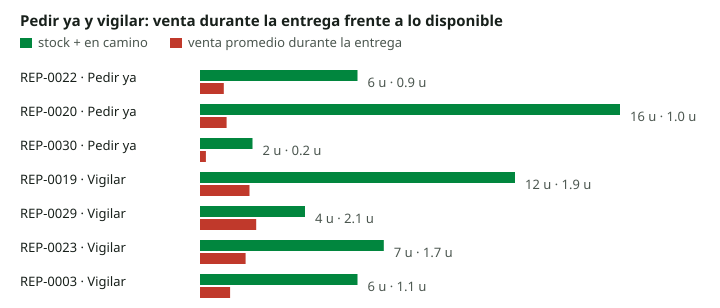

# HU-09 y SCRUM-66: alertas de reposición

Generado por `src/hu-09/generar_alertas.py` con la lógica única del motor del simulador (`motor_ref.alertas`). Dólar: 11,70 Bs por dólar (2026-11-12).

## Resultado

Estados de reposición: Pedir ya **3**, Vigilar **4**, Cubierto **23**, Sin datos **0**.

Faltante previsto con la venta promedio: ALERTA **0**, SIN_ALERTA **30**, NO_CALCULABLE **0**.

Que la venta promedio no supere lo disponible no quiere decir que no haya riesgo: el simulador prueba 1.500 futuros de venta y de plazo y cuenta en cuántos se pierde alguna venta. Por eso un repuesto puede estar en «Pedir ya» sin faltante promedio.

## Criterios

- **Pedir ya:** stock más lo que viene en camino es igual o menor que el punto de pedido.
- **Vigilar:** llega al punto de pedido, a la venta pronosticada, antes de que el proveedor pueda entregar.
- **Cubierto:** el resto.
- **Sin datos:** falta el stock, el plazo, el historial de venta o el punto de pedido. Las cifras calculadas quedan vacías, no en cero, y el motivo se informa.
- **Venta durante la entrega** = venta diaria pronosticada (SBA o media) × plazo del proveedor, sin redondear.
- **Faltante previsto** = máximo entre cero y la venta durante la entrega menos stock y en camino. La igualdad no es alerta.
- **Orden:** estado, faltante de mayor a menor, días hasta el punto de pedido y código.

## Tabla

| # | Repuesto | Estado | Faltante (HU-09) | Stock | En camino | Punto de pedido | Plazo | Venta en el plazo | Cantidad sugerida | Costo Bs |
|---|---|---|---|---|---|---|---|---|---|---|
| 1 | REP-0022 | Pedir ya | SIN_ALERTA | 1 | 5 | 8 | 60 | 0.91 | 3 | 618.45 |
| 2 | REP-0020 | Pedir ya | SIN_ALERTA | 6 | 10 | 16 | 60 | 1.01 | 2 | 397.80 |
| 3 | REP-0030 | Pedir ya | SIN_ALERTA | 2 | 0 | 2 | 40 | 0.22 | 1 | 823.45 |
| 4 | REP-0019 | Vigilar | SIN_ALERTA | 12 | 0 | 11 | 35 | 1.89 | 1 | 447.41 |
| 5 | REP-0029 | Vigilar | SIN_ALERTA | 4 | 0 | 3 | 55 | 2.14 | 1 | 854.80 |
| 6 | REP-0023 | Vigilar | SIN_ALERTA | 7 | 0 | 6 | 45 | 1.74 | 1 | 80.15 |
| 7 | REP-0003 | Vigilar | SIN_ALERTA | 6 | 0 | 5 | 50 | 1.15 | 1 | 291.45 |
| 8 | REP-0002 | Cubierto | SIN_ALERTA | 7 | 0 | 6 | 30 | 0.72 | 1 | 432.20 |
| 9 | REP-0026 | Cubierto | SIN_ALERTA | 4 | 0 | 3 | 42 | 0.99 | 0 | 0.00 |
| 10 | REP-0004 | Cubierto | SIN_ALERTA | 5 | 1 | 5 | 45 | 0.94 | 0 | 0.00 |
| 11 | REP-0008 | Cubierto | SIN_ALERTA | 4 | 0 | 3 | 30 | 0.62 | 0 | 0.00 |
| 12 | REP-0025 | Cubierto | SIN_ALERTA | 4 | 0 | 3 | 45 | 0.82 | 0 | 0.00 |
| 13 | REP-0001 | Cubierto | SIN_ALERTA | 10 | 2 | 10 | 50 | 1.54 | 0 | 0.00 |
| 14 | REP-0021 | Cubierto | SIN_ALERTA | 8 | 0 | 6 | 35 | 0.97 | 0 | 0.00 |
| 15 | REP-0006 | Cubierto | SIN_ALERTA | 5 | 0 | 4 | 50 | 0.60 | 0 | 0.00 |
| 16 | REP-0024 | Cubierto | SIN_ALERTA | 5 | 0 | 4 | 50 | 0.59 | 0 | 0.00 |
| 17 | REP-0007 | Cubierto | SIN_ALERTA | 4 | 0 | 3 | 30 | 0.32 | 0 | 0.00 |
| 18 | REP-0005 | Cubierto | SIN_ALERTA | 4 | 1 | 4 | 45 | 0.42 | 0 | 0.00 |
| 19 | REP-0014 | Cubierto | SIN_ALERTA | 2 | 0 | 1 | 30 | 0.20 | 0 | 0.00 |
| 20 | REP-0011 | Cubierto | SIN_ALERTA | 3 | 0 | 2 | 60 | 0.40 | 0 | 0.00 |
| 21 | REP-0015 | Cubierto | SIN_ALERTA | 2 | 0 | 1 | 45 | 0.29 | 0 | 0.00 |
| 22 | REP-0009 | Cubierto | SIN_ALERTA | 1 | 2 | 2 | 30 | 0.15 | 0 | 0.00 |
| 23 | REP-0028 | Cubierto | SIN_ALERTA | 3 | 1 | 3 | 42 | 0.21 | 0 | 0.00 |
| 24 | REP-0027 | Cubierto | SIN_ALERTA | 5 | 0 | 4 | 35 | 0.16 | 0 | 0.00 |
| 25 | REP-0010 | Cubierto | SIN_ALERTA | 3 | 0 | 2 | 60 | 0.25 | 0 | 0.00 |
| 26 | REP-0017 | Cubierto | SIN_ALERTA | 2 | 0 | 1 | 58 | 0.14 | 0 | 0.00 |
| 27 | REP-0012 | Cubierto | SIN_ALERTA | 3 | 0 | 2 | 58 | 0.13 | 0 | 0.00 |
| 28 | REP-0018 | Cubierto | SIN_ALERTA | 2 | 0 | 1 | 42 | 0.09 | 0 | 0.00 |
| 29 | REP-0013 | Cubierto | SIN_ALERTA | 2 | 0 | 1 | 45 | 0.09 | 0 | 0.00 |
| 30 | REP-0016 | Cubierto | SIN_ALERTA | 1 | 1 | 1 | 60 | 0.10 | 0 | 0.00 |

Ventas REALES de carparts (Hyndman y otros, 2008) con el mes adaptado; stock, plazo, punto de pedido y costo SINTÉTICOS (SCRUM-55). No hay datos de reservas ni bloqueos: el stock disponible es el registrado.
