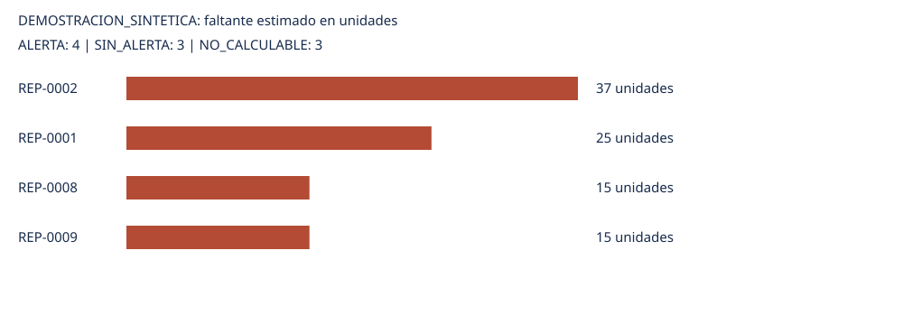

# HU-09: alertas de riesgo de faltantes

**Modo: DEMOSTRACION_SINTETICA. Datos operativos de origen ficticio/sintético; no son información operativa real de MULTIPARTES.**

Fecha de evaluación: 2026-10-20. Corte del stock: 2026-09-30. Antigüedad máxima admitida: 20 días.

## Resultados

ALERTA: **4**. SIN_ALERTA: **3**. NO_CALCULABLE: **3**.

NO_CALCULABLE conserva importes de demanda durante entrega y faltante vacíos, nunca cero. Los registros permanecen visibles.

| Prioridad | Código | Proveedor | Stock disponible | Demanda durante entrega | Plazo | Tipo días | Faltante | Estado | Motivos |
|---:|---|---|---:|---:|---:|---|---:|---|---|
| 1 | REP-0002 | Importadora Toyota | 53 | 90 | 45 | naturales | 37 | ALERTA |  |
| 2 | REP-0001 | Bosch Bolivia | 95 | 120 | 3 | naturales | 25 | ALERTA |  |
| 3 | REP-0008 | Importadora Toyota | 45 | 60 | 15 | naturales | 15 | ALERTA |  |
| 4 | REP-0009 | Suspensiones SRL | 45 | 60 | 30 | naturales | 15 | ALERTA |  |
|  | REP-0004 | NGK Bolivia | 18 | 18 | 3 | naturales | 0 | SIN_ALERTA |  |
|  | REP-0006 | Autopartes Andinas | 130 | 0 | 7 | naturales | 0 | SIN_ALERTA |  |
|  | REP-0010 | NGK Bolivia | 7 | 3 | 3 | naturales | 0 | SIN_ALERTA |  |
|  | REP-0003 | Frenos Bolivia | 31 |  |  | naturales |  | NO_CALCULABLE | COTIZACION_VENCIDA; DEMANDA_FALTANTE; PLAZO_FALTANTE |
|  | REP-0005 | Bosch Bolivia |  |  |  | naturales |  | NO_CALCULABLE | COTIZACION_VENCIDA; DEMANDA_FALTANTE; DIFERENCIA_CONTEO_PENDIENTE; PLAZO_FALTANTE; STOCK_DISPONIBLE_NO_VERIFICABLE |
|  | REP-0007 | NGK Bolivia |  |  | 15 | naturales |  | NO_CALCULABLE | DIFERENCIA_CONTEO_PENDIENTE; STOCK_DISPONIBLE_NO_VERIFICABLE |

## Información faltante y bloqueos

- COTIZACION_VENCIDA: 2 repuestos.
- DEMANDA_FALTANTE: 2 repuestos.
- DIFERENCIA_CONTEO_PENDIENTE: 2 repuestos.
- PLAZO_FALTANTE: 2 repuestos.
- STOCK_DISPONIBLE_NO_VERIFICABLE: 2 repuestos.

## Stock, duplicados y ajustes

| Código | Registrado | Conteo físico | Ajustado | IDs ajustes del corte | Duplicados excluidos | Pendientes HU-17 | Rechazos históricos |
|---|---:|---:|---:|---|---|---|---:|
| REP-0001 | 95 | 95 | 95 |  | 1004 | 1001, 1002 | 0 |
| REP-0002 | 55 | 53 | 53 | 2 | 1006 |  | 0 |
| REP-0003 | 31 | 31 | 31 |  | 1009 | 1007 | 0 |
| REP-0004 | 28 | 18 | 18 | 1 |  | 1010 | 0 |
| REP-0005 | 17 | 18 | 17 |  |  | 1012, 1013 | 0 |
| REP-0006 | 130 | 130 | 130 |  | 1016 |  | 0 |
| REP-0007 | 9 | 8 | 9 |  | 1018 |  | 4 |
| REP-0008 | 45 | 45 | 45 |  |  | 1019 | 0 |
| REP-0009 | 45 | 45 | 45 |  | 1022 |  | 0 |
| REP-0010 | 7 | 7 | 7 |  | 1024 |  | 0 |

Política de disponibilidad: asumir_libre_solo_simulacion. Solo para esta demostración se declaran reservas y bloqueos cero. Se usa el saldo de septiembre como stock hipotético del ejercicio, sin afirmar disponibilidad real al 20/10.

Se reconstruye el registrado con stock inicial y movimientos HU-17 sin DUPLICADO, incluyendo pendientes como hace HU-18. Los ajustes anteriores ya están en ese saldo; los del mismo corte se añaden una vez solo con respaldo AJUSTE_APLICADO conocido a la evaluación. Los rechazados no modifican stock. Una diferencia física pendiente impide verificar disponibilidad.

## Método y unidades

Tasa diaria constante × días naturales de consumo; serie diaria = suma de las fechas exactas de entrega. Ventana: desde el día siguiente a la evaluación hasta recepción inclusive. El stock no se proyecta automáticamente desde su corte: aceptar su antigüedad requiere una política explícita.

Demanda semanal/7 o demanda mensual/días reales de cada mes solo con distribución uniforme explícita. El calendario hábil determina recepción; se sigue consumiendo durante fines de semana intermedios. No se completan días de pronóstico ausentes ni se extrapola un horizonte corto.

Faltante = max(0, demanda durante entrega − stock disponible). ALERTA solo si demanda > stock; igualdad produce SIN_ALERTA. Entradas y resultados Decimal; las divisiones temporales se comparan como fracciones exactas para evitar microfaltantes. Sin redondear predicciones antes de comparar. Prioridad: faltante descendente, con desempate estable por código/proveedor.

Interpretación de días HU-31: Supuesto explícito de simulación: los plazos sintéticos de HU-31 se interpretan como días naturales.

## Fuentes por repuesto

| Código | Fecha de previsión | Horizonte | Naturaleza demanda | Fecha cotización | Vigencia | Naturaleza plazo |
|---|---|---|---|---|---|---|
| REP-0001 | 2026-10-20 | 2026-10-21 a 2026-12-04 | SINTETICO | 2026-09-26 | 2026-10-26 | SINTETICO |
| REP-0002 | 2026-10-20 | 2026-10-21 a 2026-12-04 | SINTETICO | 2026-09-23 | 2026-11-07 | SINTETICO |
| REP-0003 |  |  a  |  | 2026-09-17 | 2026-10-02 | SINTETICO |
| REP-0004 | 2026-10-20 | 2026-10-21 a 2026-12-04 | SINTETICO | 2026-09-18 | 2026-11-02 | SINTETICO |
| REP-0005 |  |  a  |  | 2026-09-04 | 2026-10-04 | SINTETICO |
| REP-0006 | 2026-10-20 | 2026-10-21 a 2026-12-04 | SINTETICO | 2026-09-16 | 2026-10-31 | SINTETICO |
| REP-0007 | 2026-10-20 | 2026-10-21 a 2026-12-04 | SINTETICO | 2026-09-26 | 2026-10-26 | SINTETICO |
| REP-0008 | 2026-10-20 | 2026-10-21 a 2026-12-04 | SINTETICO | 2026-09-20 | 2026-10-20 | SINTETICO |
| REP-0009 | 2026-10-20 | 2026-10-21 a 2026-11-19 | SINTETICO | 2026-09-26 | 2026-11-10 | SINTETICO |
| REP-0010 | 2026-10-20 | 2026-10-21 a 2026-12-04 | SINTETICO | 2026-09-24 | 2026-10-24 | SINTETICO |

## Supuestos y limitaciones

- DEMOSTRACION SINTETICA: las previsiones están elegidas para demostrar los estados, no fueron estimadas ni validadas con ventas de MULTIPARTES. validado=true significa revisión de los casos del ejemplo, no validación estadística de un modelo.
- Se acepta explícitamente la antigüedad de 20 días del stock solo para la simulación. No se reconstruye el stock operativo entre corte y evaluación.
- Se permite utilizar pendientes HU-17 cuando conteo y saldo ajustado coinciden; sus IDs permanecen visibles. Las discrepancias físicas de REP-0005 y REP-0007 siguen bloqueadas.
- La recepción incluye la demanda del día de llegada; la ventana comienza el día posterior a la evaluación.
- Se conserva la vigencia de cada cotización al 20/10/2026 inclusive. REP-0003 y REP-0005 no reciben un plazo alternativo al vencer su referencia.
- La tasa semanal de REP-0010 se distribuye uniformemente entre siete días naturales. REP-0009 usa treinta valores diarios explícitos.
- HU-07 exporta MAE de evaluación, no demanda futura. No se usa MAE ni se modifica HU-07. El contrato admite previsiones futuras validadas; aquí no se generan automáticamente.
- RPxxx de HU-34 permanece separado de REP-xxxx: no hay equivalencia documentada. Ventas observadas no prueban demanda no satisfecha.
- HU-31 contiene plazos sintéticos; no se deduce plazo de vigencia, precio o condiciones de pago. No se elige otro proveedor si la cotización seleccionada vence.
- Estas alertas son deterministas y no estiman una probabilidad de agotamiento. Las pruebas sintéticas demuestran el motor, no validan previsiones empresariales.

## Archivos y trazabilidad

Salidas: dataset_consolidado.csv y alertas_faltantes.csv en la carpeta de datos de este modo; este informe y prioridades.svg en su carpeta de informes. La demostración usa subcarpetas demostracion independientes.

- ajustes: `data/processed/hu-18/ajustes_inventario.csv`; SHA-256 `dddea02e131f0ddcfd37ab3861996a2d92c27494ce5cce29d7fbc9ed81762e7f`.
- conciliacion: `data/processed/hu-18/conciliacion_inventario.csv`; SHA-256 `037e34b2188c2acfe38a48e58a24a4b58aaf12e8a47da6b01b7b6c7f60c9b7ac`.
- configuracion: `data/raw/hu-09/demostracion/configuracion.json`; SHA-256 `41b9b433234b7e537b1cb72821fc2d5aa277a4f9311f29aa917796f7a98ea91f`.
- cotizaciones: `data/processed/hu-30-31/sintetico/hu31_cotizaciones_proveedor_sintetico.csv`; SHA-256 `5f986985645b7049c75025d1485cf97497754c916e358b3d9842095a0b73be71`.
- demanda: `data/raw/hu-09/demostracion/demanda_prevista.csv`; SHA-256 `bdb8cc5d527253edd667721469911e91f1306ecfb3ea272b657981995fa3f211`.
- depuracion: `data/processed/hu-17/reporte_depuracion_final.csv`; SHA-256 `5aa3b2db7bfbcc6c88109c5bb7b3f41727ae0430554258774695c5780a048a96`.
- historial: `data/processed/hu-18/historial_ajustes.csv`; SHA-256 `cf15779fe7b9f651550e00eb1bad12bbe54ee3de1da4500f8b544d0011dc204a`.
- stock_inicial: `data/raw/hu-18/stock_inicial.csv`; SHA-256 `5fe1f6cb16f4970191ec338c3a105e8ca77643aa2b42bed52a3e110608aa5183`.

Procedencias de previsión: Ejemplo artificial HU-09 sin inferencia empresarial; Serie artificial HU-09 sin inferencia empresarial.
